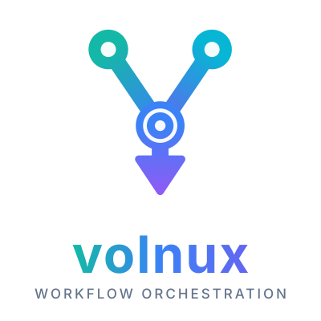

<div align="center">



**Describe workflows as graphs. Run them anywhere.**

Workflow orchestration and automation for Python, built around a small graph language,
a hybrid asyncio / multiprocess engine, and durable, human-aware execution.

[](https://github.com/nshaibu/volnux/actions)
[](https://github.com/psf/black)
[](https://codecov.io/github/nshaibu/volnux)
[](LICENSE)
[](http://makeapullrequest.com)

</div>

---

## Contents

1. [What is Volnux?](#what-is-volnux)
2. [Quick start](#quick-start)
3. [Pointy-Lang](#pointy-lang)
4. [Events](#events)
5. [Pipelines and batches](#pipelines-and-batches)
6. [How a workflow runs](#how-a-workflow-runs)
7. [Durable execution: checkpoints, suspension and human-in-the-loop](#durable-execution)
8. [Triggers](#triggers)
9. [Assets](#assets)
10. [Signals](#signals)
11. [Persistence and messaging](#persistence-and-messaging)
12. [Saga orchestration](#saga-orchestration)
13. [The server: REST API, governance and the CLI](#the-server)
14. [Deployment](#deployment)
15. [Observability](#observability)
16. [Project layout](#project-layout)
17. [Development](#development)
18. [Contributing](#contributing)
19. [License](#license)

---

## What is Volnux?

Volnux separates **what** a workflow is from **how** it runs.

* You describe the shape of the work in **Pointy-Lang**, a tiny declarative DSL
  (`Fetch -> Validate (success -> (Charge || Reserve) -> Ship)`).
* You implement each step as an **event**: a Python class or a decorated function
  that returns `(success, result)`.
* Volnux parses the graph, schedules the steps, runs them on the executor you
  choose (threads, processes, Celery), retries failures, evaluates results,
  checkpoints state, and reports what happened.

It scales from a ten-line script to a distributed deployment with a REST API,
role-based governance, triggers, human approvals, and Kubernetes manifests.

### Highlights

| | |
|---|---|
| **Pointy-Lang DSL** | Sequences, parallel fan-out, result piping, outcome branches, retries, groupings, variables and directives, with semantic analysis and DAG / CFG modes. |
| **Hybrid concurrency** | `asyncio` for I/O, thread and process pools for CPU-bound work, Celery for distributed work. Pick an executor per event. |
| **Resilient by default** | Per-event retry policies with exponential backoff, result-evaluation strategies, stop conditions, bypass hooks and a saga orchestrator for compensating transactions. |
| **Durable execution** | Events checkpoint their state, suspend to wait for a person, an external event or a condition, and are rehydrated later, possibly on another node. |
| **Triggers** | Schedule (cron), event, webhook, manual, condition, asset, chain and windowed triggers, all managed by one trigger engine. |
| **Data-centric assets** | Declare what an event produces, track materialisations and lineage, and fire workflows when an asset changes or goes stale. |
| **Pluggable persistence** | Models are stored through one mixin; back them with in-memory, SQLite, PostgreSQL or Redis stores, and use Redis or Kafka for messaging. |
| **Operable** | `volnux` CLI, FastAPI server, RBAC and audit trail, OpenTelemetry and Prometheus metrics, Docker and Kubernetes deployment. |

---

## Quick start

### Install

```bash
pip install volnux
```

Requires Python 3.8+ (the test suite is run on 3.11). Optional extras for
PostgreSQL, Redis, gRPC, Celery, Kubernetes and metrics are declared in
`pyproject.toml`.

### Your first workflow

```python
# hello.py
import typing
from volnux import EventBase, Pipeline
from volnux.execution.pipeline.fields import InputDataField


class Fetch(EventBase):
    def process(self, name: str) -> typing.Tuple[bool, typing.Any]:
        return True, f"fetched data for {name}"


class Transform(EventBase):
    def process(self, *args, **kwargs) -> typing.Tuple[bool, typing.Any]:
        # the previous step's results arrive as self.previous_result,
        # a set of EventResult objects
        return True, str(self.previous_result.first().content).upper()


class Save(EventBase):
    def process(self, *args, **kwargs) -> typing.Tuple[bool, typing.Any]:
        print("saving:", self.previous_result.first().content)
        return True, "saved"


class MyPipeline(Pipeline):
    name = InputDataField(data_type=str, required=True)

    class Meta:
        pointy = "Fetch -> Transform -> Save"


if __name__ == "__main__":
    import asyncio

    pipeline = MyPipeline(name="orders")
    asyncio.run(pipeline.start(force_rerun=True))   # start() is a coroutine
    print(pipeline.draw_ascii_graph())
```

```bash
python hello.py
```

### Scaffold a project

```bash
volnux init my_project          # create a project
cd my_project
volnux workflow init orders     # add a workflow (events, pipeline, .pty file)
volnux workflow validate        # check the Pointy files
volnux dev                      # dev server with hot reload
```

---

## Pointy-Lang

Pointy describes how work flows. Arrows show order, `||` runs work in parallel,
and parenthesised branches react to the outcome of a task.

```pointy
@mode: "DAG"
@author: "Jane Doe"

ReceiveOrder -> ValidateOrder (
    failure -> RejectOrder,
    success -> (ChargeCard || ReserveStock) -> ShipOrder
)
```

| Construct | Meaning |
|---|---|
| `A -> B` | Run `B` after `A`; `B` receives `A`'s results as `previous_result` |
| `A \|-> B` | Stream `A`'s output into `B` while `A` is still running (see [Streaming](#streaming)); an ordinary `->` when `A` does not stream |
| `A \|\| B` | Run `A` and `B` in parallel: the parallel paradigm, tasks only (binds tighter than `->`) |
| `{ A, B -> C, D }` | Cooperative execution: the comma-separated items (tasks **or subgraphs**) run concurrently, bounded by `max_concurrency` |
| `A * 3` | Retry `A` up to 3 times |
| `A (failure -> X, success -> Y)` | Branch on the task's outcome |
| `A (0 -> X, 1 -> Y, 2 -> Z)` | Numeric and custom descriptors (`@descriptor: needs_review`) |
| `ns::Task` | Namespaced task |
| `Task[retry_attempts = 3, executor = "MyExecutor"]` | Per-task options |
| `@mode: "DAG"` / `"CFG"` | Reject cycles (DAG) or allow them (CFG, the default) |

Variables, expressions, groupings (`{}` for multi-path chains), meta events and
semantic analysis are covered in the
[language reference](volnux/parser/README.md).

---

### Streaming

If an event's `process()` is a **generator**, it streams: every `(success, data)` it yields is
appended to a stream on the messaging backend, and the next task, linked with `|->`, reads it
**while the producer is still running**.

```python
class Numbers(EventBase):
    async def process(self):
        for i in range(5):
            yield True, i                      # one chunk per yield

class Double(EventBase):                       # a transform stage: consumes and produces
    async def process(self):
        async for chunk in self.input_stream():
            yield True, chunk.content * 2

class Collect(EventBase):                      # a sink: consumes, returns one result
    async def process(self):
        values = [chunk.content async for chunk in self.input_stream()]
        return True, values
```

```pointy
Numbers |-> Double |-> Collect
Numbers |-> (AuditLog || Collect)               # fan-out: both read every chunk
(Orders || Refunds) |-> Ledger                  # fan-in: one merged stream
{ Orders, Refunds -> Audit } |-> Ledger         # a cooperative group feeding a consumer
Numbers |-> Collect (failure -> Alert, success -> Publish)
```

* The tasks of a `|->` chain run together as one segment and succeed or fail together.
* A stream is an append-only log: Redis streams and Kafka are supported, and the in-memory
  backend works in a single process (the default). Set `STREAM_BACKEND_CONFIG` to use a
  different backend for streams than for the rest of the project.
* Delivery is at least once and consumers skip chunks they already handled; a failing producer
  closes its stream as failed, a failing consumer stops its producers.
* If `process()` is **not** a generator, `A |-> B` behaves like `A -> B`.
* Because members run together, a branch cannot stream (`A (1 |-> B)` is an error) and
  branches belong on the last task of the stream. A fan-in consumer reads one merged stream
  (a producer that is not a generator contributes its result as one chunk). The
  [language reference](volnux/parser/README.md#streaming-with--) lists the rules.

## Events

An event is one unit of work. It returns `(success, result)`.

### Class-based

```python
import typing
from concurrent.futures import ThreadPoolExecutor
from volnux import EventBase, RetryPolicy


class ChargeCard(EventBase):
    executor = ThreadPoolExecutor                       # where it runs
    retry_policy = RetryPolicy(max_attempts=5, backoff_factor=2.0)

    def process(self, order: dict) -> typing.Tuple[bool, typing.Any]:
        return True, {"charged": order["amount"]}
```

### Function-based

```python
from volnux.decorators import event
from volnux import RetryPolicy


@event(name="DataProcessor", retry_policy=RetryPolicy(max_attempts=3))
def process_data(self, data: dict):
    return True, {"result": data.get("value", 0) * 2}
```

### What an event gets for free

* **Executors**: thread pools, process pools, or Celery; chosen per event.
* **Retry policy**: attempts, exponential backoff, a ceiling, and which exceptions are retryable.
* **Result evaluation**: when an event fans out, decide what "success" means with
  `ResultEvaluationStrategies` (`ALL_MUST_SUCCEED`, `ANY_MUST_SUCCEED`,
  `MAJORITY_MUST_SUCCEED`, `NO_FAILURES_ALLOWED`, `at_least_n_succeed(n)`,
  `at_least_percent_succeed(p)`).
* **Control flow hooks**: `bypass()` to skip work when it is unnecessary,
  `goto()` to jump to another task, stop conditions, and `acquire_resource()` for
  resources that must survive a checkpoint.
* **Lifecycle phases and signals** for every step of execution.

---

## Pipelines and batches

A `Pipeline` binds input fields to a Pointy workflow (inline with
`Meta.pointy`, or from a `.pty` file with `Meta.file`).

```python
from volnux import Pipeline, BatchPipeline
from volnux.execution.pipeline.fields import InputDataField


class Simple(Pipeline):
    name = InputDataField(data_type=str, batch_size=5)


class SimpleBatch(BatchPipeline):
    pipeline_template = Simple


batch = SimpleBatch(name=list(range(100)))      # fans out into batches of 5
```

A pipeline is run with `await pipeline.start()` (a coroutine), can be controlled with
`pause()`, `resume()` and `stop()`, and can
render itself with `draw_ascii_graph()` or `draw_graphviz_image()`.

---

## How a workflow runs

```
 .pty / Meta.pointy                                   Python events
        │                                                   ▲
        ▼                                                   │
 ┌─────────────┐   AST    ┌──────────────┐  task nodes  ┌───┴──────────┐
 │ lexer/parser│ ───────► │  semantic    │ ───────────► │ workflow     │
 │ (PLY)       │          │  analysis    │              │ engine       │
 └─────────────┘          └──────────────┘              │ (queue-based │
                                                        │  traversal)  │
                                                        └───┬──────────┘
                           ExecutionContext per step        │
                 ┌──────────────────────────────────────────┤
                 ▼                                          ▼
        ┌─────────────────┐                      ┌────────────────────┐
        │ flows           │  dispatch to         │ checkpoint manager │
        │ single/parallel │ ──► executors        │ + rehydration      │
        │ /meta           │     (thread, process,│ (suspend/resume)   │
        └─────────────────┘      Celery)         └────────────────────┘
```

* The **parser** turns Pointy into an AST; **semantic analysis** reports errors
  and warnings before anything runs.
* The **engine** walks the graph with a work queue. Each step gets an
  `ExecutionContext` that is chained to its neighbours, giving a fractal
  execution tree with status, results, errors and metrics.
* A **flow** (single, parallel or meta) dispatches the step to its executor and
  gathers results; the **evaluator** decides success or failure.
* Sub-graphs (`{}` groupings) run in their own **sub-engines**.
* The engine owns the **checkpoint manager**, an asyncio component, so work can
  be persisted and resumed.

---

## Durable execution

Events can checkpoint, suspend and resume, which makes long waits cheap and
survivable.

An event's `communicate()` hook runs before `process()`. It may ask the outside
world for something; doing so **suspends** the task: its state is checkpointed
and every resource it holds is released. When the answer arrives, the task is
**rehydrated** (possibly on another node) with the answer injected into
`previous_result`, and `communicate()` runs again from the top.

```python
class ApproveOrder(EventBase):
    async def communicate(self, order: dict, **kwargs):
        if self.get_response() is None and order["amount"] > 100_000:
            await self.request_human_input(
                title="High-value order",
                description=f"Order {order['id']} needs sign-off",
                payload={"order": order},
                options=["approve", "reject"],
                timeout_hours=4,
            )

    async def process(self, order: dict, **kwargs):
        response = self.get_response()
        if response and response.content["decision"] == "reject":
            return False, {"reason": "human_rejected"}
        return True, {"order": order}
```

Three ways to wait:

| Call | Waits for |
|---|---|
| `request_human_input(...)` | A person (answered through the REST API, `hitl` endpoints, or a provider such as Slack) |
| `wait_for_event(event_type, ...)` | An external event |
| `wait_for_condition(fn, ...)` | A polled condition |

Behind this, a suspension is a persisted `ExternalCommunicationQueueEntry`; the
answer (or a timeout) travels over the messaging backend; the
**`RehydrationManager`** picks it up, takes an atomic claim so exactly one
worker resumes it, and continues the **whole workflow** from where it stopped.
Interrupted resumes are recovered on restart, with a cap on repeated attempts.

---

## Triggers

Triggers start workflows. One `TriggerEngine` runs them all, keeps their state in
a `TriggerStateRecord`, and can be controlled from the CLI.

| Trigger | Fires when | Notes |
|---|---|---|
| `ManualTrigger` | `await trigger.invoke(...)` is called | Optional confirmation; refuses when disabled |
| `SchedulerTrigger` | A cron schedule is due | Uses Celery Beat; a worker publishes a `TriggerEvent` that the engine receives |
| `EventTrigger` | A matching `TriggerEvent` is published | Filter by event type, data pattern and timestamp window |
| `WebhookTrigger` | An HTTP request arrives | Framework-agnostic; HMAC-SHA256 verification and optional replay protection |
| `ConditionalTrigger` | A function becomes true | Edge or level triggering, sync or async conditions |
| `AssetTrigger` | An asset is materialised or goes stale | One activation per stale episode |
| `WorkflowChainTrigger` | Another workflow finishes | Filter by status |
| `LinearChainTrigger` | A sequence of triggers fires in order | Per-step timeout, data carried between steps |
| `WindowedTrigger` | A condition over several event streams holds | Time-sliced aggregators, window timeout |
| `RehydrationManager` | (a manager, not a workflow trigger) | Resumes suspended workflows |

```python
from volnux.engine.workflows.trigger.triggers import EventTrigger, WebhookTrigger
from volnux.engine.workflows.trigger.event import TriggerEvent

EventTrigger("process_order", ["order.created"], event_pattern={"region": "eu"})

WebhookTrigger(
    "deploy_check",
    endpoint_path="/hooks/deploy",
    secret_token="s3cr3t",
    timestamp_header="x-webhook-timestamp",   # replay protection
)

# publishing an event (from any process that shares the messaging backend)
await TriggerEvent.publish(
    TriggerEvent(event_type="order.created", source="shop", data={"region": "eu"})
)
```

```bash
volnux trigger list                 # inspect trigger states
volnux trigger pause <trigger-id>   # change state from the CLI; the engine applies it
volnux trigger_engine ...           # start / stop / status of the trigger engine
```

---

## Assets

Declare what an event produces, and Volnux tracks it.

```python
from volnux import EventBase
from volnux.decorators import asset
from volnux.asset import AssetKey, FreshnessPolicy


@asset(
    key=AssetKey("cleaned_orders"),
    description="Orders with nulls removed",
    group="order_processing",
    freshness_policy=FreshnessPolicy(maximum_lag_minutes=60),
    upstream_keys=[AssetKey("raw_orders")],
)
class CleanOrders(EventBase):
    async def process(self, **kwargs):
        return True, [r for r in kwargs["orders"] if r]
```

The **asset catalog** records every materialisation (versions, upstream
versions, producing event and execution), answers "is this asset stale?" (never
produced, freshness exceeded, or an upstream is newer), and serves lineage.
`AssetTrigger` turns those facts into workflow runs.

---

## Signals

Hook into the lifecycle without touching events:

```python
from volnux.decorators import listener
from volnux.signal.signals import pipeline_execution_start


@listener(pipeline_execution_start, sender=Simple)
def on_start(**kwargs):
    print("started", kwargs)
```

Pipeline signals (`pipeline_pre_init`, `pipeline_post_init`,
`pipeline_execution_start/end`, `pipeline_stop`, `pipeline_shutdown`), event
signals (`event_init`, `event_called`, `event_phase_changed`,
`event_execution_start/end/retry/failed/cancelled/aborted/paused/resumed`),
suspension signals (`event_execution_suspended`, `task_rehydrated`,
`hitl_requested`), and batch and metrics signals are provided. Listeners may be
sync or async; the registry uses weak references and is thread-safe.

---

## Persistence and messaging

Everything persistent (trigger states, checkpoints, execution contexts, asset
materialisations, governance records) is a model that mixes in one of two
integrations, so storage is a configuration choice rather than code:

* `KeyValueStoreIntegrationMixin`: `save`, `get`, `filter` (with ordering and
  paging), `all`, `count`, `update`, `delete`, with `*_async` aliases.
* `MessagingBackendIntegrationMixin`: pub/sub (`publish`, `subscribe`),
  push/pop queues (`push`, `pop`, `enqueue`, `dequeue`) and append-only streams.

| Store | Key-value | Messaging |
|---|---|---|
| In-memory | yes (tests, single process) | yes |
| SQLite | yes | |
| PostgreSQL | yes | |
| Redis | yes | yes |
| Kafka | | yes |

Fields such as `DateTimeField`, `DateField`, `ListField`, `ObjectField` and
`ForeignKeyField` handle encoding to and from the store, and `StorageRoute`
resolves schema and channel names per project and node. Models are built on
[formax](https://pypi.org/project/formax-py/).

---

## Saga orchestration

`volnux.backends.saga` coordinates multi-step operations with compensation:
steps run in order, and if one fails the completed steps are compensated in
reverse. It includes recovery of interrupted sagas and a dead-letter queue for
compensations that cannot complete.

---

## The server

`volnux serve --role api` runs the FastAPI application; `--role worker` runs the
execution side. Run it from a project directory (or pass `--project-dir`).

* **Fails loudly.** A project that cannot load, a pre-flight check that fails (every
  database in `DATABASES` must answer; the Celery broker too when the project has a
  schedule trigger), or a server that cannot start (no `SECRET_KEY`, port in use)
  stops the command with a message and a non-zero exit status.
* **API.** Needs `SECRET_KEY` (or `DEBUG`); starts the trigger engine once the HTTP
  server is up; SIGTERM stops it gracefully.
* **Worker.** Starts the checkpoint manager (`CHECKPOINT_CONFIG`, stored in the
  `checkpoints` database) under a health monitor, plus metrics and telemetry; on
  SIGTERM it drains the checkpoint queue (up to `CHECKPOINT_DRAIN_TIMEOUT`) and
  stops. It has no inbound interface yet, so `--worker-port` is unused.

The API (`/api/v1/...`) covers:

* **Workflows and executions**: execute, list, inspect, trace, pause, resume, stop
* **Triggers**: list, create, delete
* **Human-in-the-loop**: list requests, respond
* **Governance**: organizations, teams, users, roles, delegations, approvals and
  approval chains, break-glass access, notifications, and an audit trail
* **EventHub**: a registry of reusable, versioned components
* **Nodes**: registration, health, decommissioning
* **Auth** and **status** endpoints

### CLI

| Command | Purpose |
|---|---|
| `volnux init` | Create a project |
| `volnux workflow init \| list \| validate \| run` | Manage and run workflows |
| `volnux dev` | Dev server with hot reload (API, trigger engine, rehydration manager, metrics) |
| `volnux serve --role api\|worker` | Production API or worker |
| `volnux trigger list \| inspect \| pause \| resume \| stop` | Control triggers |
| `volnux trigger_engine ...` | Start, stop and inspect the trigger engine |
| `volnux migrate up \| status` | Database migrations |
| `volnux manifest generate \| validate` | Project manifests |
| `volnux shell` | Interactive shell |
| `volnux version` / `volnux help` | Version and help |

---

## Deployment

* **Docker**: `deploy/docker/` has a Dockerfile and a compose file with
  Prometheus, Grafana, Tempo and an OpenTelemetry collector.
* **Kubernetes**: `deploy/k8s/` has manifests for the API and worker
  deployments, PostgreSQL, two Redis instances (checkpoints and the Celery
  broker), an OTel collector, autoscaling and disruption budgets, network
  policies, ingress, nightly database backups and a ServiceMonitor. See
  [`deploy/k8s/README.md`](deploy/k8s/README.md).

Run it as two roles: **api** replicas (REST API, trigger engine, rehydration
manager) and **worker** replicas (workflow engine, checkpoints), scaled
independently.

---

## Observability

Volnux traces and measures itself with [OpenTelemetry](https://opentelemetry.io).
Nothing is recorded, and nothing is slowed down, until you turn it on; when it is
on, the same trace follows a run from the API through the trigger engine, a Celery
worker or a Kubernetes Job, down to each event.

### Turn it on

Telemetry starts inside `initialise_workflows()`, the first thing every way of
running workflows calls (the CLI, `volnux serve` / `dev`, Celery workers, Kubernetes
Jobs, your `init.py`). Set the `OTEL_*` settings, in the environment (with the
`VOLNUX_` prefix) or in the project's `settings.py` / `init.py`, and there is
nothing to call:

```bash
export VOLNUX_OTEL_ENABLED=true
export VOLNUX_OTEL_BACKEND=grafana                     # grafana | tempo | datadog | jaeger | otlp
export VOLNUX_OTEL_ENDPOINT=http://otel-collector:4317 # OTLP gRPC
export VOLNUX_OTEL_SAMPLE_RATE=0.2                     # keep 20% of traces
```

| Setting | Default | Meaning |
| --- | --- | --- |
| `OTEL_ENABLED` | `False` | Master switch. |
| `OTEL_BACKEND` | `"grafana"` | Where traces and metrics go: `grafana`/`tempo`, `datadog`, `jaeger`, or `otlp` for any OTLP collector. |
| `OTEL_ENDPOINT` | `http://localhost:4317` | OTLP gRPC endpoint. |
| `OTEL_TEMPO_URL`, `OTEL_DATADOG_URL` | `None` | Backend-specific endpoint, if different from `OTEL_ENDPOINT`. |
| `OTEL_SERVICE_NAME` | project name | `service.name` of the telemetry. |
| `OTEL_SAMPLE_RATE` | `1.0` | Fraction of traces kept (0.0 to 1.0). |
| `ROLE` (`VOLNUX_ROLE`) | `"api"` | `volnux.role` label of the telemetry; `volnux serve --role worker` sets it. |

Initialisation itself is traced: a `setup.initialise_workflows` span with one child
per phase (`setup.configure_reporters`, `setup.discover_workflows`,
`setup.load_workflows` with `registry.load` inside it, `setup.configure_executor`),
the time the configuration took (`setup.config_load_ms`) as an attribute, and the
`setup.duration` metric. Telemetry starts right after the configuration is loaded,
because the `OTEL_*` settings may come from it. A process that already started
telemetry itself (below) is left as it is, and a telemetry problem never stops
initialisation.

To start it yourself instead, in your own process:

```python
from volnux.otel import initialize_otel, shutdown_otel

initialize_otel(
    "billing-workflows",
    environment="production",
    backends=["tempo", "datadog"],
    config={
        "tempo": {"endpoint": "http://tempo:4317"},
        "datadog": {"agent_url": "http://datadog-agent:4317"},
    },
    sample_rate=0.25,
)

# ... run workflows: they are instrumented ...

shutdown_otel()   # flushes spans and metrics, restores the instrumented classes
```

`initialize_otel` is safe to call again: it does nothing while already running, and
after `shutdown_otel()` it starts afresh with the new configuration.

### What you get

One trace per run, with this shape:

```
workflow.<Pipeline>                         the run (Pipeline.start)
└─ engine.execute                           the workflow engine
   └─ context.dispatch                      one per task group, chained
      ├─ coordinator.execute_async
      └─ flow.run.<SingleFlow|ParallelFlow|StreamFlow>
         └─ event.execute.<Event>           lasts until the event finishes
```

and, around it, spans for the parts of the framework that start and feed runs:

| Part | Spans | Metrics |
| --- | --- | --- |
| Trigger engine | `trigger.activate`, `trigger.fire`, `trigger_engine.start` / `stop` / `force_stop` | `trigger.activations` |
| Workflow executors (async, Celery, Kubernetes) | `workflow.run`, `executor.<Class>.execute` | `workflow.run.count`, `workflow.run.duration` |
| Workflow registry | `registry.load`, `registry.load_source` | `registry.load.duration` |
| Checkpoints and rehydration | `checkpoint.persist`, `checkpoint.build_event`, `rehydrate.event`, `rehydrate.resume`, `rehydrate.node` | `checkpoint.operations`, `checkpoint.duration` |
| Sagas | `saga.execute`, `saga.resume`, `saga.step`, `saga.compensate`, `saga.dead_letter`, `saga.recovery.save` / `load` / `delete` | `saga.executions`, `saga.duration` |
| Messaging (`MessagingBackendIntegrationMixin`) | `messaging.publish` / `push` / `pop` / `pop_many` / `enqueue` / `dequeue` / `queue_delete` / `stream_append` / `stream_read` / `stream_ack` | `messaging.operations`, `messaging.duration` |
| Remote batch streaming | `remote.execute_task`, `remote.read_stream` | |
| Flows and events | `flow.run.*`, `event.execute.*`, `flow.initialize_event`, `flow.map_events_to_executor` | `flow.duration`, `event.duration`, `task.count`, `error.count`, `executor.usage`, `parallel_tasks.active` |
| Engine and system | | `engine.queue_length`, `engine.target_workers`, `engine.actual_workers`, `engine.parallel_tasks`, `resource.cpu_usage`, `resource.memory_usage` (MB) |

Volnux's signals (`pipeline_execution_start`, `event_execution_retry`, ...) are added
as `signal.<name>` events to the span that is current when they are emitted. An
event that fails is an error span; an event that reports an error result (the way
events normally fail) is too, even though the workflow routes on it and completes.

### Traces across processes

When a workflow is sent to a Celery worker or a Kubernetes Job, the carrier that
carries the run's context (`volnux.context`) also carries the active trace
(`traceparent`). The worker's spans join the dispatcher's trace, with no code on
your side. A task function you write yourself gets the same with
`@dispatch_worker_task`.

### From your own code

```python
from volnux.otel.utils import add_span_attribute, add_span_event, get_current_trace_id

add_span_attribute("customer.id", customer_id)
add_span_event("validated", {"rows": 1000})
logger.info("processing", extra={"trace_id": get_current_trace_id()})
```

### Good to know

* **Safe by default.** Instrumentation never changes what your code returns or
  raises. Without `initialize_otel` the wrapped methods behave as before.
* **Secrets stay out.** Pipeline inputs whose name suggests a secret (`password`,
  `token`, `secret`, `api_key`, ...) are recorded as `[redacted]`; every attribute
  value is cut to 256 characters; message and result contents are never recorded.
* **Metric labels are bounded** (class, workflow, executor and outcome names; never
  ids), so they do not blow up your metrics backend. Ids are span attributes only.
* **Debugging.** `initialize_otel(..., debug=True)` turns on debug logging for
  `volnux.otel` and `opentelemetry`. No spans? Check `OTEL_ENABLED`, that the endpoint
  is reachable, and `OTEL_SAMPLE_RATE`.

The full reference (every span and metric, the configuration, extending the
instrumentation, testing it) is in [`volnux/otel/readme.md`](volnux/otel/readme.md).
Prometheus metrics and Grafana dashboards are under `deploy/docker/`.

---

## Project layout

```
volnux/
├── parser/        Pointy-Lang: lexer, grammar, semantic analysis, code generation
├── event/         EventBase and its phases
├── mixins/        Event behaviours (retry, executor, checkpoint, communicate) and the
│                  key-value / messaging integrations
├── engine/        Workflow engines, resume, and the trigger engine + triggers
├── execution/     ExecutionContext, coordinator, checkpoint/rehydration, pipelines
├── flows/         Single, parallel and meta flows
├── executors/     Thread / process / Celery executor integration
├── asset/         Asset keys, catalog, materialisations, freshness policies
├── backends/      Stores, messaging, fields, query compiler, saga
├── signal/        Signals and default handlers
├── governance/    Governance events, publishing, reporting
├── app/           FastAPI application (v1 routes)
├── cli/           The `volnux` command
├── otel/          OpenTelemetry instrumentation
└── models/        Governance models (users, roles, workflows, approvals, ...)
deploy/            Docker and Kubernetes
examples/          Runnable examples
tests/unittests/   Unit tests
```

---

## Development

```bash
git clone https://github.com/nshaibu/volnux.git
cd volnux
pip install -e ".[dev]"

# tests (async tests carry an explicit @pytest.mark.asyncio)
python -m pytest tests/unittests

# formatting
black volnux tests
```

Notes for contributors:

* The remote (TCP / gRPC / XML-RPC) executors are being moved to a separate
  package that implements `concurrent.futures.Executor`.
* Examples live in [`examples/`](examples/README.md); the
  [tutorial](TUTORIAL.md) and the Sphinx docs in `docs/` go deeper.

---

## Contributing

Issues and pull requests are welcome. Please read the
[Code of Conduct](CODE_OF_CONDUCT), follow the [style guide](python_style_guide.md)
(Black formatting), and add tests with your change.

---

## License

Volnux is released under the **GNU General Public License v3.0**; see
[LICENSE](LICENSE).

Copyright © 2025 Nafiu Shaibu.
