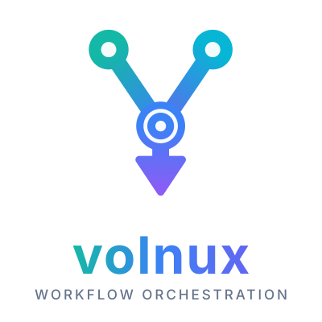

<div style="display:flex; justify-content:center; align-items:center;">
    
</div>


[](https://github.com/nshaibu/volnux/actions)
[](https://github.com/psf/black)
[](https://pypi.python.org/pypi/event-pipeline)
[](https://pypi.python.org/pypi/event-pipeline)
[](https://pypi.python.org/pypi/event-pipeline)
[](https://codecov.io/github/nshaibu/volnux)

[](http://makeapullrequest.com)

# Table of Contents
1. [Introduction](#Introduction)
   1. [Installation](#Installation)
   2. [Requirements](#Requirements)
2. [Usage](#Usage)
    1. [Pipeline](#pipeline)
       1. [Defining Pipelines](#defining-pipeline)
       2. [Defining input data field](#defining-input-data-field)
       3. [Defining Pipeline Structure Using Pointy language](#defining-pipeline-structure)
       4. [Pointy Language](#pointy-language)
       5. [Executing Pipeline](#executing-pipeline)
       6. [Batch Processing](#pipeline-batch-processing)
       7. [Scheduling](#scheduling)
          1. [Periodic Scheduling (CRON)](#periodic-scheduling-cron)
    2. [Event](#defining-events)
       1. [Defining Events](#define-the-event-class)
       2. [Specify the Executor for your Event](#specify-the-executor-for-the-event)
       3. [Function-Based Events](#function-based-events)
       4. [Event Result Evaluation](#event-result-evaluation)
       5. [Specifying Event Retry Policy](#specifying-a-retry-policy-for-event)
          1. [RetryPolicy Class](#retrypolicy-class)
          2. [Configuring The Retry Policy](#configuring-the-retrypolicy)
          3. [Assigning Retry Policy](#assigning-the-retry-policy-to-an-event)
          4. [How the retry Policy Works](#how-the-retry-policy-works)
   3. [Signals](#signals)
      1. [Soft Signal framework](#soft-signaling-framework)
         1. [Default Signals](#default-signals)
         2. [Connecting Signal Listeners](#connecting-listeners-to-signals)
   4. [Telemetry](#telemetry)
      1. [Overview](#telemetry-overview)
      2. [Usage](#telemetry-usage)
      3. [Network Telemetry](#network-telemetry)
      4. [Metrics Publishing](#metrics-publishing)
         1. [Publishers](#available-publishers)
         2. [Dashboard Templates](#dashboard-templates)

# Introduction
**Simplify complex process automation with a flexible, high-performance framework.**

This library tackles the challenges of building reliable, scalable workflows by 
providing a clear separation between coordination and execution. It uses a declarative DSL, 
**Pointy-Lang**, to model your pipelines while managing the underlying complexity of concurrency, 
state, and task dependencies.

Build resilient automation that can handle anything from simple data processing to distributed, event-driven systems.

## Features
- **Pointy-Lang DSL**: Define task dependencies, conditional logic, and parallel execution using an intuitive, graph-based syntax.
- **Hybrid Concurrency**: Leverage asyncio for non-blocking I/O and multiprocessing for true parallel execution of CPU-bound tasks.
- **Distributed Processing**: Supports remote task execution and manages state across multiple processes with minimal overhead.
- **Extensible Architecture**: Easily integrate custom event logic, task executors, and signals to fit any use case.

## Installation
To install the framework, simply use pip:

```bash
pip install volnux
```

# Requirements
- Python>=3.8
- ply==3.11 
- treelib==1.7.0
- more-itertools<=10.6.0
- apscheduler<=3.11.0
- graphviz==0.20.3 (Optional)

# Usage

# Pipeline

## Defining Pipelines

To define a pipeline, import the `Pipeline` class using `from volnux import Pipeline` and create a new class that
inherits from it. This custom class will define the behavior and structure of your pipeline.

```python
from volnux import Pipeline

class MyPipeline(Pipeline):
    # Define input fields as class attributes here
    pass

```

## Defining Input Data Field
Import the `InputDataField` (or another field class) from the `volnux.execution.pipeline.fields` module.

The `InputDataField` class is used to declare input fields for your pipeline. Define these fields as class attributes
on your pipeline class; they represent the data that will flow through the pipeline. Events can access input field
values by including the field name in their `process` method signature.

```python
from volnux import Pipeline
from volnux.execution.pipeline.fields import InputDataField

class MyPipeline(Pipeline):
    # Define input fields as attributes
    input_field = InputDataField(data_type=str, required=True)  # Define an input field

```

## Defining Pipeline Structure Using Pointy language
The next step is to define the structure and flow of your pipeline using the pointy language. 
The pointy file provides a structured format to describe how the pipeline should execute, 
including the order of tasks, conditions, and dependencies.

```pty
Fetch -> Process -> Execute -> SaveToDB -> Return
```

The pointy file `.pty` describes the flow of tasks and their dependencies, allowing you to build dynamic 
and conditional pipelines based on the results of previous executed event.

By default, if the name of your pointy file matches the name of your pipeline class, the library 
will automatically load the pointy file for you. For example, if your class is named MyPipeline, 
it will automatically look for a file named `MyPipeline.pty`.

If you want to use a pointy file with a different name, you can define a Meta subclass inside 
your pipeline class. 

This subclass should specify the file or pointy property:

- `pointy`: The string of the pointy script.
- `file`: The full path to your pointy file.

Example of how to define the Meta subclass:
```python
class MyPipeline(Pipeline):
    class Meta:
        pointy = "A->B->C"  # Pointy script
        # OR
        file = "/path/to/your/custom_pipeline.pty"  # Full path to your pointy file

# You can also define the options as dictionary

class MyPipeline(Pipeline):
    meta = {
        "pointy": "A->B->C",
        # OR
        "file": "/path/to/your/custom_pipeline.pty"
    }
```

## Pointy Language
Pointy Language is a domain-specific language (**DSL**) designed to model and execute event-based workflows. It allows 
you to define sequences of operations, conditional branching, parallel execution, and result piping in a simple and 
expressive syntax. The language uses arrows (`->`, `||`, `|->`) to represent event flow, direction, and parallelism. 
This documentation provides an overview of the syntax and examples of common usage.

The Pointy Language DSL provides a concise and expressive way to define the structure, flow, and logic of your event-driven pipelines, making it easier to manage complex dependencies and execution paths.

### Operators

The following operators are used in Pointy Language to define the flow, dependencies, and logic of your event-driven pipelines.

- **Directional Operator (`->`):**
The `->` operator is used to define a sequential flow of events. It represents the execution of one event followed by another. 
It indicates that the first event must be completed before the second event begins.
```pty
A -> B   # Execute event A, then execute event B
```

- **Parallel Operator (`||`):**
The `||` operator is used to execute two or more events in parallel. The events are executed concurrently, allowing for 
parallel execution.
```pty
A || B   # Execute event A and event B in parallel
```

- **Pipe Result Operator (`|->`):**
The `|->` operator is used to pipe the result of one event to another. It can be used in conjunction with sequential 
or parallel operations. This allows the output of one event to be passed as input to another event.
```pty
A |-> B  # Pipe the result of event A into event B
```

- **Conditional Branching (`(0 -> X, 1 -> Y)`):**
Conditional branching is used to define different execution paths based on the success or failure of an event. 
The condition is checked after the event's execution: `0` represents failure, and `1` represents success. 
Based on these outcomes, the next event(s) are chosen.
```pty
A -> B (0 -> C, 1 -> D)  # If B fails (0), execute C; if B succeeds (1), execute D
In Pointy Language, the `*` operator is used to retry an event in the case of failures or exceptions.
The syntax supports both postfix (`A * 3`) and prefix (`3 * A`) notation to specify the retry factor, and both forms are accepted; however, postfix notation (`A * 3`) is canonical and preferred in documentation and examples.
The `*` operator specifies that the event should be retried a certain number of times if an exception occurs. 
This number is known as the retry factor. The factor must be greater than 1 for the retry operation to be activated. 
The retry operation triggers for all exceptions that occur during the execution of the event. However, it can be 
configured to exclude certain exceptions. If specific exceptions are listed in the event configuration, 
retries will not be attempted for those exceptions.
If a retry policy has already been set for the event, the `*` operator will override the maximum retry count defined earlier. 
This means that the retry factor specified by * will take precedence, even if there was a previous retry limit in place.
retries will not be attempted for those exceptions.
If a retry policy has already been set for the event, the `*` operator will override the maximum retry count defined earlier. 
This means that the retry factor specified by * will take precedence, even if there was a previous retry limit in place.
```pty
A * 3 # Retries the A event a maximum of 3 times if any exception occurs

51 * A # Retries the A event a maximum of 51 times if any exception occurs
```

- **Descriptors (`0 - 9`):** 
Descriptors are numeric values used for conditional branching in Pointy Language. 
They are integral to defining which event node should be executed based on the success or failure state of the 
previous event. Descriptors are associated with specific execution outcomes—such as success or failure—and 
help determine the flow of execution.
  - ***Descriptor `0` (Failure)***: 
    Descriptor `0` denotes a failure state. It is used to specify the node to execute when the previous event has failed. 
    If an event fails, the flow of execution will follow the branch defined by descriptor `0`.
  - ***Descriptor `1` (Success)***:
  Descriptor 1 denotes a success state. It is used to specify the node to execute when the previous event has succeeded. 
  If an event succeeds, the flow of execution will follow the branch defined by descriptor `1`.
  - ***Descriptors `3 - 9` (User-defined Conditions)***: 
  Descriptors 3 through 9 are available for user-defined conditions. These descriptors can be used to specify additional 
  conditional logic in your workflow. The user can assign any condition to these descriptors, allowing for more complex 
  branching logic. Each of these descriptors can be assigned to events based on custom conditions defined by the user.

**Example of mapping a custom condition to a descriptor in code:**

Suppose you want to use descriptor `3` to represent a custom condition, such as "input value is greater than 100". You can map this in your event or pipeline configuration as follows:

```pty
A -> B (0 -> C, 1 -> D, 3 -> E)  # Use descriptor 3 to define a custom condition for event E
```
In this case:

- If event B fails (0), execute event C.
- If event B succeeds (1), execute event D.
- If the user-defined condition (descriptor 3) is met, execute event E.

## Syntax Guide

### Single Event
A single event is represented by a single event name. It can be thought of as a unit of work that is executed.
```pty
A    # Single event A
```

### Directional Operation
A directional operation represents the execution of one event followed by the execution of another event. 
The arrow (`->`) denotes the sequence of execution.
```pty
A -> B   # Execute event A, then execute event B
```

### Parallel Operation
Parallel operations are used to execute two or more events concurrently. The `||` operator denotes parallel execution.
```pty
A || B   # Execute event A and event B in parallel
```
You can also pipe the results of parallel events to another event using the `|->` operator.
```pty
A || B |-> C  # Execute event A and event B in parallel, then pipe their results to event C
```

### Two Events with Result Piping
This syntax allows you to pipe the result of one event to another. The `|->` operator is used to send the 
output of an event as input to another event.

```pty
A |-> B  # Pipe the result of event A into event B
```

### Multiple Events with Branching
Branching allows you to define different paths of execution based on the success or failure of events. 
A branch consists of a condition (either 0 for failure or 1 for success) that leads to different events.

```pty
A -> B (0 -> C, 1 -> D)  # If event B fails (0), execute event C; if event B succeeds (1), execute event D
```

### Multiple Events with Sink
In this case, an event executes, and depending on the result (0 for failure, 1 for success), it moves to 
different events. 
The `->` operator continues the execution flow, while the branches determine what to do with success and failure.

```pty
A (0 -> B, 1 -> C) -> D  # Execute event A, then on failure (0) execute event B, on success (1) execute event C, then finally execute event D
```

### Example
This is an example of a more complex workflow using the constructs described above. It demonstrates multiple levels of 
branching, parallel execution, result piping, and the use of descriptors.

```pty
A -> B (
    0->C (
        0 |-> T,  # If C fails, pipe result to T
        1 -> Z    # If C succeeds, execute Z
    ),
    1 -> E    # If B succeeds, execute event E
) -> F (
    0 -> Y,   # If F fails, execute event Y
    1 -> Z    # If F succeeds, execute event Z
)
```

In this example:

1. Event A is executed first.
2. Then, event B is executed. If event B fails (0), event C is executed. If event B succeeds (1), event E is executed.
3. Event C has its own branching: if it fails (0), event T is executed, and if it succeeds (1), event Z is executed.
4. Finally, event F is executed. If event F fails (0), event Y is executed, and if event F succeeds (1), event Z is executed.

This is the graphical representation of the above pipeline


To draw your pipeline:
```python
# instantiate your pipeline class
pipeline = MyPipeline()

# draw ascii representation
pipeline.draw_ascii_graph()

# draw graphical representation # (requires graphviz, xdot)
pipeline.draw_graphviz_image(directory=...)

```

## Executing Pipeline
Execute your pipeline by making calls to the `start` method:

```python
# instantiate your pipeline class
pipeline = MyPipeline(input_field="value")

# call start
pipeline.start()
```

## Pipeline Batch Processing
The Pipeline Batch Processing feature enables you to process multiple batches of data in parallel, enhancing performance 
and efficiency when dealing with large datasets or time-sensitive tasks. This is accomplished using a pipeline template, 
which defines the structure of the pipeline, and the BatchPipeline class, which orchestrates the parallel execution of 
pipeline instances.

### Create a Pipeline Template
The first step is to create a pipeline template by defining a pipeline class that inherits from the Pipeline class. 
The pipeline template serves as a scheme that outlines the structure and logic of the pipeline, including inputs, 
transformations, and outputs. 

It acts as the blueprint for the kind of pipeline you want to create and execute. 
This template will be used to generate multiple instances of the pipeline, each one customized for different execution 
contexts, depending on the data you plan to process.

***Example:***
```python
from volnux import Pipeline
from volnux.execution.pipeline.fields import InputDataField, FileInputDataField

class Simple(Pipeline):
    name = InputDataField(data_type=list, batch_size=5)
    book = FileInputDataField(required=True, chunk_size=1024)
```

***Explanation:***

Simple is a subclass of Pipeline that defines the pipeline structure.
name is an InputDataField with data_type=list and a batch_size of 5, meaning the pipeline will process data in batches of 5.

## Create the Batch Processing Class
Next, define the batch processing class by inheriting from BatchPipeline. This class is responsible for orchestrating 
the parallel execution of the pipeline template you just created.

***Example:***

```python
from volnux import BatchPipeline
from volnux.signal import SoftSignal

class SimpleBatch(BatchPipeline):
    pipeline_template = Simple
    listen_to_signals = [SoftSignal('task_completed'), SoftSignal('task_failed')]
```

***Explanation:***

- `SimpleBatch` inherits from BatchPipeline and sets the pipeline_template to the Simple pipeline class, meaning that 
SimpleBatch will use the Simple pipeline as its template for processing batches.
- `listen_to_signals` defines the signals the batch pipeline listens to (such as task_completed or task_failed), allowing 
you to monitor the progress and react to events during execution.

## How the Batch Pipeline Works
The BatchPipeline class is the core component that manages the execution of batches. It uses the defined pipeline 
template to create separate pipeline instances, each of which processes a different batch of data in parallel. 
The pipeline template must be a subclass of Pipeline.

- ***Attributes:***
    - `pipeline_template`: The pipeline class (such as Simple) that serves as the template for creating individual pipeline instances.
    - `listen_to_signals`: A list of signals that the batch pipeline listens to. Signals provide a way to track events 
    such as task completion or failure.

### How It Works:
The BatchPipeline class orchestrates the execution of the pipeline template in parallel across multiple batches.
- `Pipeline template`: The pipeline_template defines the structure of each pipeline in the batch. Each batch processes
a different subset of data according to the template.
- `Signal handling`: The `listen_to_signals` attribute is used to capture and respond to events such as task completion 
or failures. This helps in tracking progress and debugging.

## Define the Data Set for Processing
Once the pipeline class and batch processing class are set up, prepare the dataset you want to process. This dataset 
will be split into smaller batches based on the batch size defined in the pipeline template (batch_size=5 in the example).

## Configure and Execute the Batch Pipeline
After defining the batch pipeline class, you can configure it to process your data. The BatchPipeline will automatically 
create multiple instances of the pipeline_template (such as Simple) and execute them in parallel.

To trigger the batch pipeline execution, you just need to invoke it, and it will process the batches as defined.

## Monitor and Optimize Execution
You can integrate OpenTelemetry to monitor the performance of the batch pipeline and collect telemetry data, 
such as execution time and error rates.

Additionally, Soft Signals are used to signal key events during the execution, like task_completed or task_failed, 
which helps in tracking the progress and responding to events in real-time.

***Optimization:***
Adjust the max number of tasks per child configuration to balance the workload and optimize throughput.
Fine-tune the configuration based on system resources to ensure optimal performance during parallel execution.

***Full Example:***
Batch Pipeline with Parallel Execution
Here’s a full example that demonstrates the creation and configuration of a batch processing pipeline:

```python
from volnux import BatchPipeline, Pipeline
from volnux.execution.pipeline.fields import InputDataField

class Simple(Pipeline):
    name = InputDataField(data_type=list, batch_size=5)

class SimpleBatch(BatchPipeline):
    pipeline_template = Simple

def on_result(result):
    print("failed" if result.exception else "done")

# Create an instance of SimpleBatch with the data, then run it (inside an async function)
simple_batch = SimpleBatch(name=["item1", "item2", "item3"])
await simple_batch.execute(on_result)  # on_result is called per finished pipeline
```
***Explanation:***
- Simple is the pipeline template that processes batches of 5 items at a time.
- SimpleBatch inherits from `BatchPipeline`, using Simple as the template for parallel execution.
- `on_result` is called for every pipeline as it finishes, with its outcome.
`await simple_batch.execute(on_result)` runs the pipeline and processes data in parallel batches.

# Scheduling

The `Pipeline Scheduler` is a component designed to manage and schedule pipeline jobs for execution. It allows you to 
define and execute pipeline jobs at specified times or intervals.

This module provides an easy-to-use interface for scheduling pipelines, ensuring that jobs run at the right time in a reliable and organized manner.

## Periodic Scheduling (CRON)

pass


# Defining Events

## Define the Event Class

To define an event, you need to inherit from the EventBase class and override the process method. 
This process method defines the logic for how the event is executed.

```python
from volnux import EventBase

class MyEvent(EventBase):
    def process(self, *args, **kwargs):
        # Event processing logic here
        return True, "Event processed successfully"
```

## Specify the Executor for the Event

Every event must specify an executor that defines how the event will be executed. Executors are 
responsible for managing the concurrency or parallelism when the event is being processed.

Executors implement the Executor interface from the concurrent.futures._base module in the 
Python standard library. If no executor is specified, the `DefaultExecutor` will be used.

```python
from concurrent.futures import ThreadPoolExecutor

class MyEvent(EventBase):
    executor = ThreadPoolExecutor  # Specify executor for the event
    
    def process(self, *args, **kwargs):
        # Event processing logic here
        return True, "Event processed successfully"

```

## Executor Configuration

The `ExecutorInitializerConfig` class is used to configure the initialization of an executor 
(such as ProcessPoolExecutor or ThreadPoolExecutor) that manages event processing. This class allows you 
to control several aspects of the executor’s behavior, including the number of workers, task limits, 
and thread naming conventions.

### Configuration Fields
The ExecutorInitializerConfig class contains the following configuration fields. If you are using 
`ProcessPoolExecutor` or `ThreadPoolExecutor`, you can configure additional properties to control the 
behavior of the executor:

1. `max_workers`
    - ***Type***: `int` or `EMPTY`
    - ***Description***: Specifies the maximum number of workers (processes or threads) that can be used to execute 
    the event. If this is not provided, the number of workers defaults to the number of processors available on the machine.
    - ***Usage***: Set this field to an integer value if you wish to limit the number of workers. If left as EMPTY, 
    the system will use the default number of workers based on the machine’s processor count.

2. `max_tasks_per_child`
   - ***Type***: `int` or `EMPTY`
   - ***Description***: Defines the maximum number of tasks a worker can complete before being replaced by a new worker. 
   This can be useful for limiting the lifetime of a worker, especially for long-running tasks, to avoid memory buildup 
   or potential issues with task state.
   - ***Usage***: Set this field to an integer to limit the number of tasks per worker. If set to EMPTY, workers will 
   live for as long as the executor runs.

3. `thread_name_prefix`
    - ***Type***: `str` or `EMPTY`
    - ***Description***: A string to use as a prefix when naming threads. This helps identify threads related to event 
    processing during execution.
    - ***Usage***: Set this field to a string to provide a custom thread naming convention. If left as EMPTY, 
    threads will not have a prefix.

Here’s an example of how to use the ExecutorInitializerConfig class to configure an executor for event processing:

```python
from volnux import ExecutorInitializerConfig

# Configuring an executor with a specific number of workers, max tasks per worker, and thread name prefix
config = ExecutorInitializerConfig(
    max_workers=4,
    max_tasks_per_child=50,
    thread_name_prefix="event_executor_"
)

class MyEvent(EventBase):
    executor = ThreadPoolExecutor
    
    # Configure the executor
    executor_config = config
    
    def process(self, *args, **kwargs):
        # Event processing logic here
        return True, "Event processed successfully"

# Or you can config it, using dictionary as below
class MyEvent(EventBase):
    executor = ThreadPoolExecutor
    
    # Configure the executor
    executor_config = {
        "max_workers": 4,
        "max_tasks_per_child": 50,
        "thread_name_prefix": "event_executor_"
    }
    
    def process(self, *args, **kwargs):
        # Event processing logic here
        return True, "Event processed successfully"
```

In this example:

The executor will allow 4 workers (processes or threads, depending on the executor type).
Each worker will process a maximum of 50 tasks before being replaced.
The thread names will begin with the prefix event_executor_, making it easier to identify threads related 
to event processing.

## Default Behavior
If no fields are specified or left as EMPTY, the executor will use the following default behavior:

max_workers: The number of workers will default to the number of processors on the machine.
max_tasks_per_child: Workers will continue processing tasks indefinitely, with no limit.
thread_name_prefix: Threads will not have a custom prefix.
For example, the following code creates an executor with default behavior:

```python
config = ExecutorInitializerConfig()  # Default configuration
```


## Function-Based Events
In addition to defining events using classes, you can also define events as functions. 
This is achieved by using the event decorator from the decorators module.

The decorator allows you to configure the executor, just like in class-based events, 
providing flexibility for execution.

```python
from volnux.decorators import event

# Define a function-based event using the @event decorator
@event()
def my_event(*args, **kwargs):
    # Event processing logic here
    return True, "Event processed successfully"
```

The event decorator allows you to define an event as a simple function. You can also configure the 
executor for the event's execution using parameters like max_workers, max_tasks_per_child, and thread_name_prefix.

```python
from volnux.decorators import event
from concurrent.futures import ThreadPoolExecutor

# Define a function-based event using the @event decorator
@event(
    executor=ThreadPoolExecutor,               # Define the executor to use for event execution
    max_workers=4,                             # Specify max workers for ThreadPoolExecutor
    max_tasks_per_child=10,                    # Limit tasks per worker
    thread_name_prefix="my_event_executor",    # Prefix for thread names
    stop_on_exception=True                     # Flag to stop execution if an exception occurs
)
def my_event(*args, **kwargs):
    # Event processing logic here
    return True, "Event processed successfully"
```
The `@event` decorator registers the function as an event in the pipeline and configures the executor for the event execution.

## Event Result Evaluation
The `EventExecutionEvaluationState` class defines the criteria for evaluating the success or failure of an event 
based on the outcomes of its tasks. The states available are:

- `SUCCESS_ON_ALL_EVENTS_SUCCESS`: The event is considered successful only if all the tasks within the event succeeded. 
If any task fails, the evaluation is marked as a failure. This is the `default` state.

- `FAILURE_FOR_PARTIAL_ERROR`: The event is considered a failure if any of the tasks fail. Even if some tasks succeed, 
a failure in any one task results in the event being considered a failure.

- `SUCCESS_FOR_PARTIAL_SUCCESS`: This state treats the event as successful if at least one task succeeds. Even if 
other tasks fail, the event will be considered successful as long as one succeeds.

- `FAILURE_FOR_ALL_EVENTS_FAILURE`: The event is considered a failure only if all tasks fail. If any task succeeds, 
the event is marked as successful.

Each state can be used to configure how an event's success or failure is determined, allowing for flexibility 
in managing workflows.

### Example Usage
Here's how you can set the execution evaluation state in your event class:

```python
from volnux import EventBase, EventExecutionEvaluationState

class MyEvent(EventBase):
    execution_evaluation_state = EventExecutionEvaluationState.SUCCESS_ON_ALL_EVENTS_SUCCESS
    
    def process(self, *args, **kwargs):
        return True, "obrafour"

```

## Specifying a Retry Policy for Event
In some scenarios, you may want to define a retry policy for handling events that may fail intermittently. 
The retry policy allows you to configure things like the maximum number of retry attempts, the backoff strategy, 
and which exceptions should trigger a retry.

The retry policy can be specified by importing the RetryPolicy class and configuring the respective fields. 
You can then assign this policy to your event class, ensuring that failed events will be retried based on 
the configured settings.

### RetryPolicy Class
The RetryPolicy class allows you to define a policy with the following parameters:

```python
@dataclass
class RetryPolicy(object):
    max_attempts: int   # Maximum retry attempts
    backoff_factor: float  # Backoff time between retries
    max_backoff: float # Maximum allowed backoff time
    retry_on_exceptions: typing.List[typing.Type[Exception]]  # List of exceptions that will trigger a retry
```

### Configuring the RetryPolicy
To configure a retry policy, you can create an instance of RetryPolicy and set its fields based on your desired 
settings. The retry policy can also be defined as a dictionary.

For example:

```python
from volnux.base import RetryPolicy

# Define a custom retry policy
retry_policy = RetryPolicy(
    max_attempts=5,  # Maximum number of retries
    backoff_factor=0.1,  # 10% backoff factor
    max_backoff=5.0,  # Max backoff of 5 seconds
    retry_on_exceptions=[ConnectionError, TimeoutError]  # Retry on specific exceptions
)

# Or define the retry policy as a dictionary
retry_policy = {
    "max_attempts": 5,
    "backoff_factor": 0.1,
    "max_backoff": 5.0,
    "retry_on_exceptions": [ConnectionError, TimeoutError]
}
```
In this example:
- `max_attempts` specifies the maximum number of times the event will be retried before it gives up.
- `backoff_factor` defines how long the system will wait between retry attempts, increasing with each retry.
- `max_backoff specifies` the maximum time to wait between retries, ensuring it doesn't grow indefinitely.
- `retry_on_exceptions` is a list of exception types that should trigger a retry. If an event fails due to 
one of these exceptions, it will be retried.

### Assigning the Retry Policy to an Event

Once you have defined the RetryPolicy, you can assign it to your event class for processing. 
The policy can be passed as a dictionary containing the retry configuration.

Here’s how you can assign the retry policy to your event class:

```python
import typing
from volnux import EventBase


class MyEvent(EventBase):
    
    # assign instance of your RetryPolicy or RetryPolicy dictionary
    retry_policy = retry_policy 

    def process(self, *args, **kwargs) -> typing.Tuple[bool, typing.Any]:
        pass

```

In this example, the `retry_policy` class variable is assign the retry configuration.

# How the Retry Policy Works
When an event is processed, if it fails due to an exception in the retry_on_exceptions list, the retry logic kicks in:

- The system will retry the event based on the `max_attempts`.
- After each retry attempt, the system waits for a time interval determined by the `backoff_factor` 
and will not exceed the `max_backoff`.
- If the maximum retry attempts are exceeded, the event will be marked as failed.

- This retry mechanism ensures that intermittent failures do not cause a complete halt in processing and 
allows for better fault tolerance in your system.

# Signals

## Soft Signaling Framework

The Signaling Framework is a core component of the Event-Pipeline library, enabling you to connect custom behaviors 
to specific points in the lifecycle of a pipeline and its events. The framework utilizes the `SoftSignal` class, 
which allows for easy connection of listeners to signals. This enables the implementation of custom logic that 
can be executed at critical moments in your pipeline's operation.

### Default Signals

The following default signals are provided for various stages of the pipeline:

#### Initialization Signals

- **`pipeline_pre_init`**:
  - **Description**: This signal is emitted before the pipeline is initialized. It allows you to execute logic right at the start of the initialization process.
  - **Arguments**:
    - `cls`: The class of the pipeline being initialized.
    - `args`: Positional arguments passed during initialization.
    - `kwargs`: Keyword arguments passed during initialization.

- **`pipeline_post_init`**:
  - **Description**: This signal is emitted after the pipeline has been successfully initialized. You can use this to perform actions that depend on the pipeline being ready.
  - **Arguments**:
    - `pipeline`: The instance of the initialized pipeline.

#### Shutdown Signals

- **`pipeline_shutdown`**:
  - **Description**: Emitted when the pipeline is shutting down. This is an opportunity to clean up resources or save state.
  - **Arguments**: None

- **`pipeline_stop`**:
  - **Description**: Triggered when the pipeline is stopped. This can be useful for halting ongoing operations or notifications.
  - **Arguments**: None

#### Execution Signals

- **`pipeline_execution_start`**:
  - **Description**: This signal is emitted when the execution of the pipeline begins. It's useful for logging or starting monitoring.
  - **Arguments**:
    - `pipeline`: The instance of the pipeline that is starting execution.

- **`pipeline_execution_end`**:
  - **Description**: Triggered when the execution of the pipeline has completed. You can use this for final logging or cleanup.
  - **Arguments**:
    - `execution_context`: Context information about the execution, such as status and results.

#### Event Execution Signals

- **`event_execution_init`**:
  - **Description**: Emitted when an event execution is initialized. This can be used to set up necessary preconditions for the event processing.
  - **Arguments**:
    - `event`: The event being processed.
    - `execution_context`: The context in which the event is executed.
    - `executor`: The executor responsible for handling the event.
    - `call_kwargs`: Additional keyword arguments for the event execution.

- **`event_execution_start`**:
  - **Description**: This signal is emitted when the execution of a specific event starts. It’s useful for tracking the start of event processing.
  - **Arguments**:
    - `event`: The event that is starting.
    - `execution_context`: The context in which the event is being executed.

- **`event_execution_end`**:
  - **Description**: Triggered when the execution of an event ends. This is useful for post-processing or finalizing the event's outcomes.
  - **Arguments**:
    - `event`: The event that has finished execution.
    - `execution_context`: The context in which the event was executed.
    - `future`: A future object representing the result of the event execution.

- **`event_execution_retry`**:
  - **Description**: Emitted when an event execution is retried. This is useful for tracking retries and implementing custom backoff strategies.
  - **Arguments**:
    - `event`: The event being retried.
    - `execution_context`: The context for the retry execution.
    - `task_id`: The identifier for the specific task being retried.
    - `backoff`: The backoff strategy or duration.
    - `retry_count`: The current count of retries that have been attempted.
    - `max_attempts`: The maximum number of allowed attempts.

- **`event_execution_retry_done`**:
  - **Description**: Triggered when a retry of an event execution is completed. This can be useful for logging or updating the state after retries.
  - **Arguments**:
    - `event`: The event that has completed its retry process.
    - `execution_context`: The context in which the event was executed.
    - `task_id`: The identifier for the task that was retried.
    - `max_attempts`: The maximum number of attempts that were allowed for the task.

### Connecting Listeners to Signals

To leverage the signaling framework, you can connect listeners to these signals. Listeners are functions that will be 
called when a specific signal is emitted. Here's how to connect a listener:

```python
from volnux.signal.signals import pipeline_execution_start
from volnux import Pipeline

def my_listener(pipeline):
    print(f"Execution starting for pipeline: {pipeline}")

# Connect the listener to the signal
pipeline_execution_start.connect(my_listener, sender=Pipeline)
``` 
***Or***
```python
from volnux.decorators import listener
from volnux.signal.signals import pipeline_pre_init
from volnux import Pipeline

@listener(pipeline_pre_init, sender=Pipeline)
def my_lister(sender, signal, *args, **kwargs):
    print("Executing pipeline")

```

# Telemetry

## Telemetry Overview

The event-pipeline library includes built-in telemetry capabilities for monitoring and tracking event execution, performance metrics, and network operations. The telemetry module provides:

- Event execution tracking (timing, success/failure, retries)
- Network operation monitoring for remote execution
- Performance metrics collection
- JSON-formatted metrics output

## Telemetry Usage

To enable telemetry collection in your pipeline:

```python
from volnux.telemetry import monitor_events, get_metrics

# Enable telemetry collection
monitor_events()

# Run your pipeline...

# Get metrics after execution
metrics_json = get_metrics()
print(metrics_json)

# Get specific metrics
failed_events = get_failed_events()
slow_events = get_slow_events(threshold_seconds=2.0)
retry_stats = get_retry_stats()
```

The telemetry module automatically tracks:
- Event execution time
- Success/failure status
- Error messages
- Retry attempts
- Process IDs

## Network Telemetry

For pipelines using remote execution, the telemetry module provides detailed network operation metrics:

```python
from volnux.telemetry import get_failed_network_ops, get_slow_network_ops

# Get metrics for failed network operations
failed_ops = get_failed_network_ops()

# Get metrics for slow network operations (> 1 second)
slow_ops = get_slow_network_ops(threshold_seconds=1.0)
```

Network telemetry tracks:
- Operation latency
- Bytes sent/received
- Connection errors
- Host/port information

The telemetry data can be used to:
- Monitor pipeline performance
- Identify bottlenecks
- Debug failures
- Optimize remote operations
- Track retry patterns

## Metrics Publishing

The telemetry module supports publishing metrics to various monitoring systems through a flexible publisher adapter system. This allows you to visualize and analyze pipeline metrics using your preferred monitoring tools.

### Available Publishers

#### Elasticsearch Publisher
Publishes metrics to Elasticsearch, allowing visualization in Kibana:

```python
from volnux.telemetry import ElasticsearchPublisher

es_publisher = ElasticsearchPublisher(
    hosts=["localhost:9200"],
    index_prefix="pipeline-metrics"
)
monitor_events([es_publisher])
```

#### Prometheus Publisher
Exposes metrics for Prometheus scraping, compatible with Grafana:

```python
from volnux.telemetry import PrometheusPublisher

prometheus_publisher = PrometheusPublisher(port=9090)
monitor_events([prometheus_publisher])
```

#### Grafana Cloud Publisher
Publishes metrics directly to Grafana Cloud:

```python
from volnux.telemetry import GrafanaCloudPublisher

grafana_publisher = GrafanaCloudPublisher(
    api_key="your-api-key",
    org_slug="your-org"
)
monitor_events([grafana_publisher])
```

#### Composite Publisher
Publish metrics to multiple backends simultaneously:

```python
from volnux.telemetry import CompositePublisher

publisher = CompositePublisher([
    es_publisher,
    prometheus_publisher,
    grafana_publisher
])
monitor_events([publisher])
```

### Dashboard Templates

Sample dashboard templates are provided in the examples directory:

#### Prometheus + Grafana Dashboard
The `examples/telemetry/prometheus_dashboard.json` template includes:
- Event duration metrics
- Retry statistics
- Network throughput
- Latency tracking

Import into Grafana after configuring Prometheus as a data source.

#### Elasticsearch + Kibana Dashboard
The `examples/telemetry/elasticsearch_dashboard.json` template includes:
- Event duration distribution
- Status breakdown
- Network performance metrics
- Error tracking

Import into Kibana after setting up the index pattern.

### Installation

To use metrics publishing, install the required dependencies:

```bash
pip install "event-pipeline[metrics]"
```

This will install the optional dependencies needed for each publisher:
- elasticsearch-py for Elasticsearch
- prometheus-client for Prometheus
- requests for Grafana Cloud

### Custom Publishers

You can create custom publishers by implementing the MetricsPublisher interface:

```python
from volnux.telemetry import MetricsPublisher

class CustomPublisher(MetricsPublisher):
    def publish_event_metrics(self, metrics: EventMetrics) -> None:
        # Implement event metrics publishing
        pass

    def publish_network_metrics(self, metrics: dict) -> None:
        # Implement network metrics publishing
        pass
```

# Contributing
We welcome contributions! If you have any improvements, fixes, or new features, 
feel free to fork the repository and create a pull request.

# Reporting Issues
If you find a bug or have suggestions for improvements, please open an issue in the repository. 
Provide as much detail as possible, including steps to reproduce the issue, expected vs. actual behavior, and any relevant logs or error messages.

# License
This project is licensed under the GNU GPL-3.0 License - see the LICENSE file for details.
